

  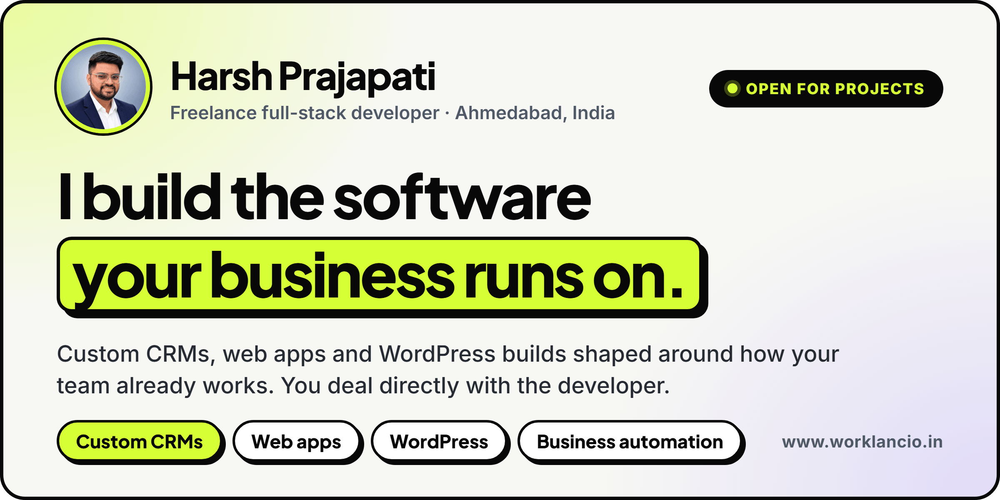

  &nbsp;
  &nbsp;
  

## Hi, I'm Harsh

I'm a freelance full-stack developer in Ahmedabad, India. I've been building for the web since 2018 and freelancing since 2022.

I work with business owners and small teams who have outgrown spreadsheets, scattered WhatsApp threads and manual follow-ups. I turn that into one clear system the whole team can use. You talk directly to the person writing the code, from the first call to launch and after.

See my services, pricing and full case studies at [worklancio.in](https://www.worklancio.in).

## What I build

**Custom CRMs and business dashboards** 
See leads, projects, payments and your team's work in one place, with numbers you can trust.

**Web apps** 
Portals, internal tools and SaaS products that load fast, work on any phone and stay easy to change.

**WordPress plugins and sites** 
Fast sites your team can edit on its own, and custom plugins when off-the-shelf ones fall short.

**Business automation and integrations** 
Connect the tools you already pay for, so the repetitive work runs on its own.

## Featured work

### Worklancio: a work and billing app for freelancers and agencies

<a href="https://youtu.be/1IluZ9-uzC8">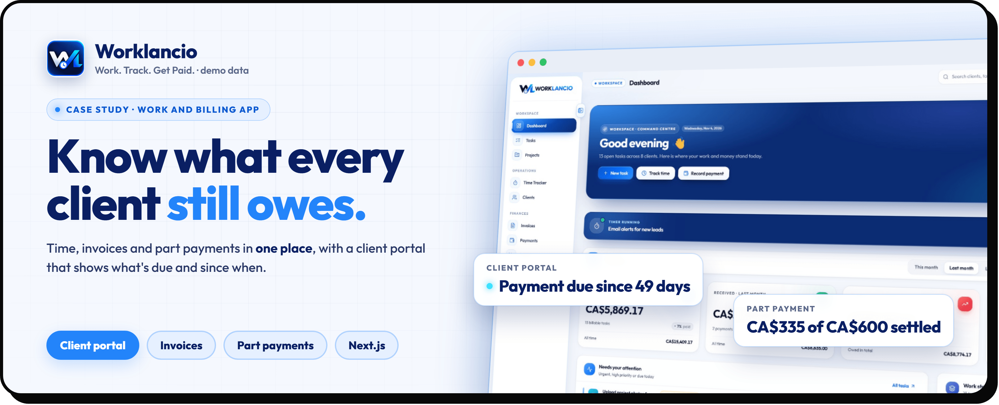</a>

**Your client shouldn't have to email you to ask what they owe.**

**Case study · my own build, Worklancio (Work. Track. Get Paid.).** I built one place for clients, time, invoices and payments. Every hour starts on a task and ends on an invoice, and each client gets a private portal that shows what's due, since when, and what every payment settled.

- Clients with sub-clients and brands, each project at its own rate
- A live timer plus quick manual entries
- Invoices numbered for you from unpaid work, ready as PDF
- Part payments split across tasks, so every balance is exact
- A client portal with "due since X days" tags and a payments log
- Read-only share links with an expiry date

> "As a freelancer, I used to lose track of which hours I'd billed and who still owed me. Worklancio keeps my time, invoices and payments in one place, so I always know what's paid."
>
> **Julie** · Canada

**Stack:** Next.js · React · TypeScript · PostgreSQL · Row Level Security

<a href="https://youtu.be/1IluZ9-uzC8">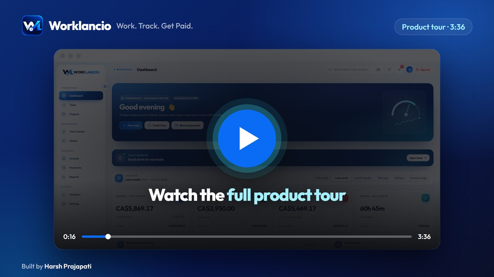</a>

[Watch the full product tour on YouTube (3:36)](https://youtu.be/1IluZ9-uzC8)

Screens show demo data.

[Read the full case study on my website](https://www.worklancio.in/work/worklancio)

**Freelancer or agency chasing payments by email? I'll build you a portal your clients actually check, so you always know who has paid. [Let's talk.](https://wa.me/919898528376?text=Hi%20Harsh%2C%20I%20saw%20your%20GitHub%20profile%20and%20have%20a%20project%20in%20mind.)**

---

### Projectly: time and project portal for a creative studio

<a href="https://youtu.be/Xc8GPErRKlM">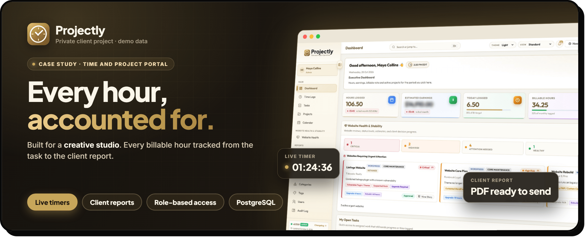</a>

**Your team sells time. When hours live in notebooks and chat threads, some of them never reach an invoice.**

**Case study · client project for a creative studio, shown under the portfolio name Projectly.** One portal where every billable hour is tracked, from the task it belongs to all the way to the client report. No more chasing timesheets at the end of the month, and no more guessing what a project really cost.

- A live timer on every task, plus quick manual entries
- Tasks with checklists, owners and repeating reminders
- Projects, budgets, a calendar and filters by client, person and category
- Monthly reports and client-ready PDF reports
- Website Health reviews, an audit log and role-based access from admin to view-only client

> "Harsh did an excellent job building Projectly CRM. The platform is well-structured, easy to use, and covers everything we needed to manage projects and track time efficiently. Great communication and attention to detail throughout the process. Highly recommended!"
>
> **Anonymous Client** · USA

**Stack:** JavaScript · PostgreSQL · Row Level Security

<a href="https://youtu.be/Xc8GPErRKlM">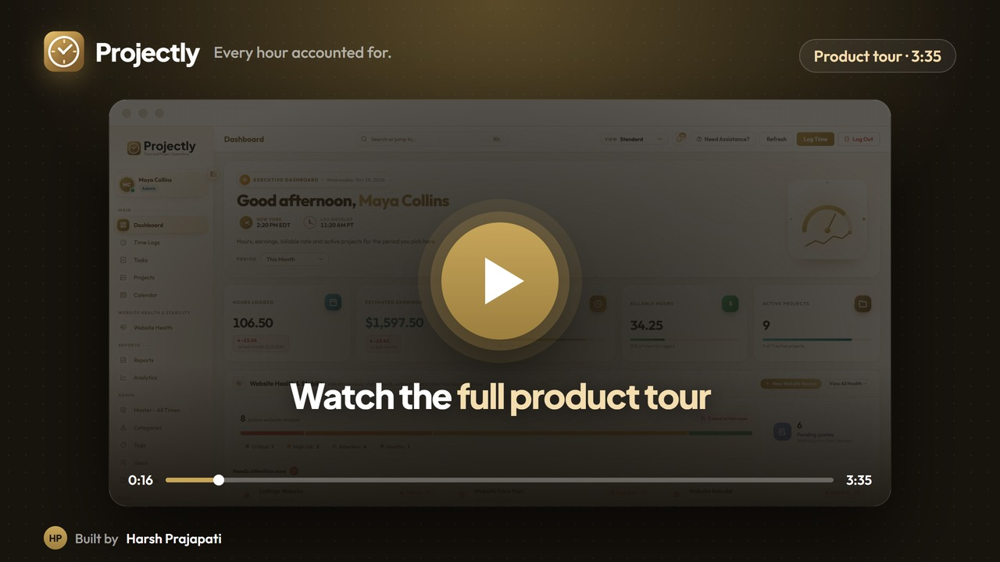</a>

[Watch the full walkthrough on YouTube (3:35)](https://youtu.be/Xc8GPErRKlM)

Screens show demo data. The code and live system are private.

[Read the full case study on my website](https://www.worklancio.in/work/projectly)

**Run an agency or studio that bills by the hour? I'll build a portal around how your team already works, so every hour gets billed. [Let's talk.](https://wa.me/919898528376?text=Hi%20Harsh%2C%20I%20saw%20your%20GitHub%20profile%20and%20have%20a%20project%20in%20mind.)**

---

### UCS CRM: operations CRM for UCS Projects

<a href="https://youtu.be/G6QfV2QkRIs">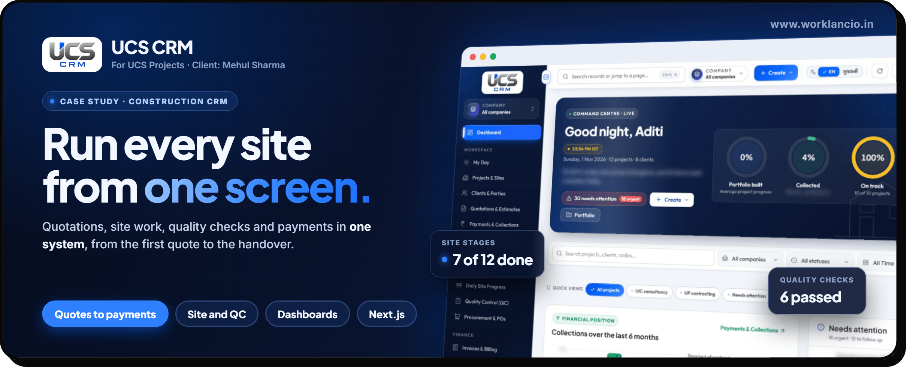</a>

**Case study · client project for [UCS Projects](https://ucsprojects.in/) ([@ucsprojects](https://www.instagram.com/ucsprojects)), a construction and interiors firm. Client: Mehul Sharma.** One system that follows every project from the first quotation to the final handover, so the office and the site team work from the same data.

- Quotations through to payments and collections
- Projects, site execution and daily site diaries
- Procurement, accounts and quality checks (QC)
- Role-based access, so each person sees only what they need
- Live dashboards for collections, margins and project status

> "Harsh Prajapati did an excellent job developing the CRM for UCS Projects. His understanding, professionalism, and attention to detail made the entire process smooth. Highly recommended for his quality work and dedication. Great experience!"
>
> **UCS Projects** · Client: Mehul Sharma

**Stack:** Next.js · React · Node.js · TypeScript · Tailwind CSS · PostgreSQL

<a href="https://youtu.be/G6QfV2QkRIs">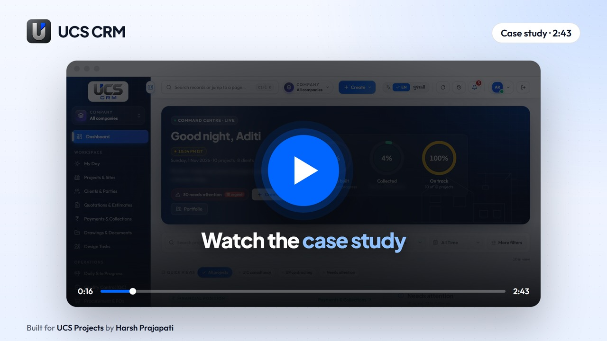</a>

[Watch the full walkthrough on YouTube (2:43)](https://youtu.be/G6QfV2QkRIs)

Screens show demo data. The code and live system are private.

[Read the full case study on my website](https://www.worklancio.in/work/ucs-crm)

**Want one for your business? [Let's talk.](https://wa.me/919898528376?text=Hi%20Harsh%2C%20I%20saw%20your%20GitHub%20profile%20and%20have%20a%20project%20in%20mind.)**

---

### CapMitra Edit

<a href="https://capmitra-app.vercel.app">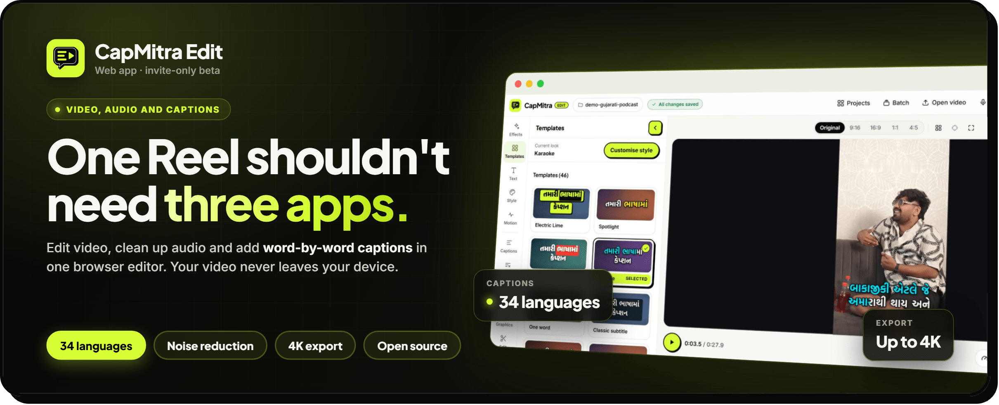</a>

Video, audio and captions in one browser editor. A multi-track timeline, noise reduction and music, word-by-word captions in 34 languages, and MP4 export up to 4K. Your video never leaves your device. Currently in invite-only beta.

<a href="https://www.youtube.com/watch?v=m36a8vHzkaY">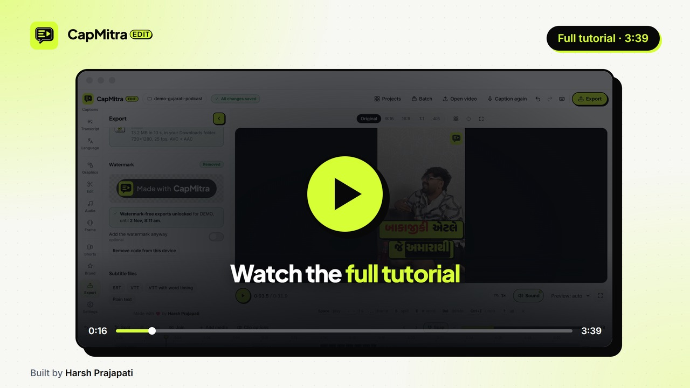</a>

[Watch the full tutorial on YouTube (3:39)](https://www.youtube.com/watch?v=m36a8vHzkaY)

[Case study](https://www.worklancio.in/work/capmitra) · [Live app](https://capmitra-app.vercel.app) · [Code](https://github.com/xaviermsd/capmitra-app)

---

### EvoFox Ronin Web Configurator

<a href="https://ronin.xaviermsd.workers.dev">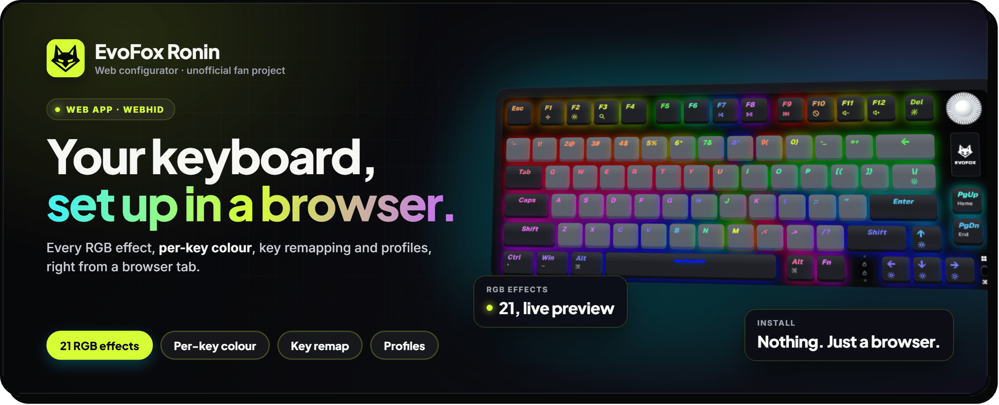</a>

Set up the EvoFox Ronin wireless keyboard right in the browser over WebHID. All 21 RGB effects with a live preview, per-key colour, key remapping and profiles, with nothing to install.

An unofficial fan project, not affiliated with Amkette or EvoFox.

[Case study](https://www.worklancio.in/work/evofox-ronin) · [Live app](https://ronin.xaviermsd.workers.dev) · [Code](https://github.com/xaviermsd/evofox-ronin-configurator)

---

### FieldPilot: AI &amp; JSON Copilot for ACF

<a href="https://wordpress.org/plugins/fieldpilot-for-acf/">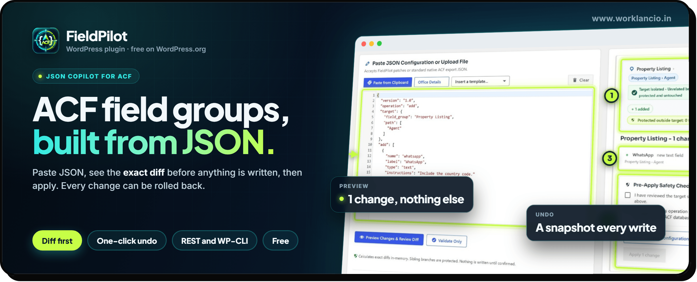</a>

Build ACF field groups from JSON. Copy a prompt with your real field names, paste the reply back, see the exact diff and apply. Every change can be rolled back. Free on WordPress.org.

<a href="https://youtu.be/FjoeySz05xw">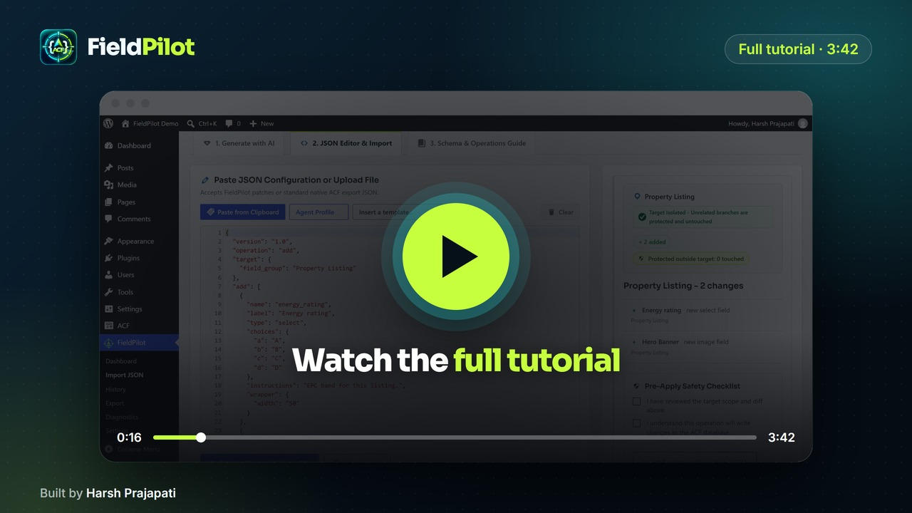</a>

[Watch the full tutorial on YouTube (3:42)](https://youtu.be/FjoeySz05xw)

[Case study](https://www.worklancio.in/work/fieldpilot) · [WordPress.org](https://wordpress.org/plugins/fieldpilot-for-acf/) · [Code](https://github.com/xaviermsd/fieldpilot-for-acf)

---

### MenuNest: Smart Menu Manager for WordPress

<a href="https://wordpress.org/plugins/menunest-smart-menu-manager/">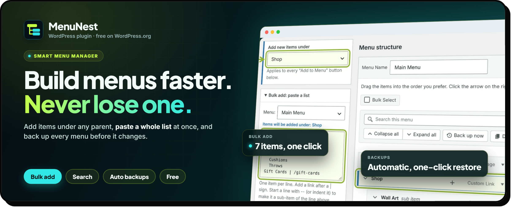</a>

Build big WordPress menus without dragging. Add items under any parent, paste a whole list at once, and back up, restore, import and export menus with a preview first. Free on WordPress.org.

<a href="https://www.youtube.com/watch?v=SljKJXaSWe8">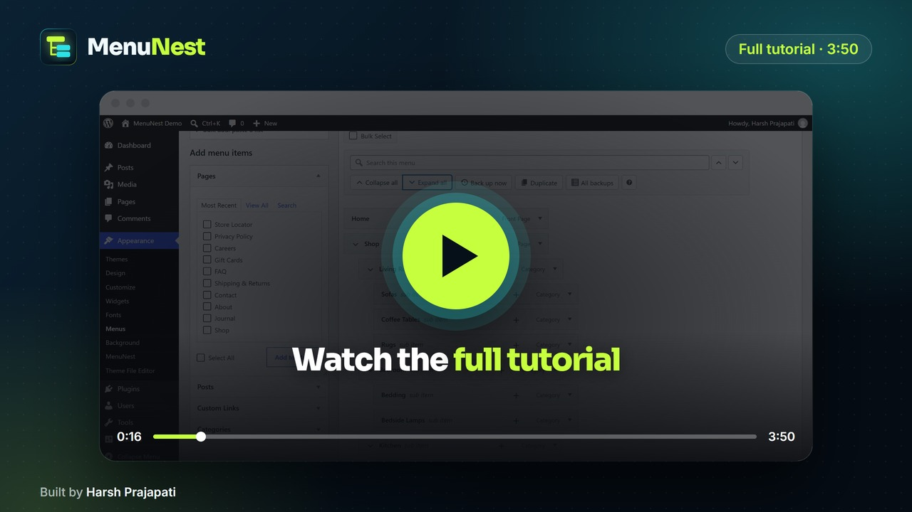</a>

[Watch the full tutorial on YouTube (3:50)](https://www.youtube.com/watch?v=SljKJXaSWe8)

[Case study](https://www.worklancio.in/work/menunest) · [WordPress.org](https://wordpress.org/plugins/menunest-smart-menu-manager/) · [Code](https://github.com/xaviermsd/menunest-smart-menu-manager)

---

### Moving &amp; Storage Volume Calculator for WordPress

<a href="https://youtu.be/raBU40QdFeY">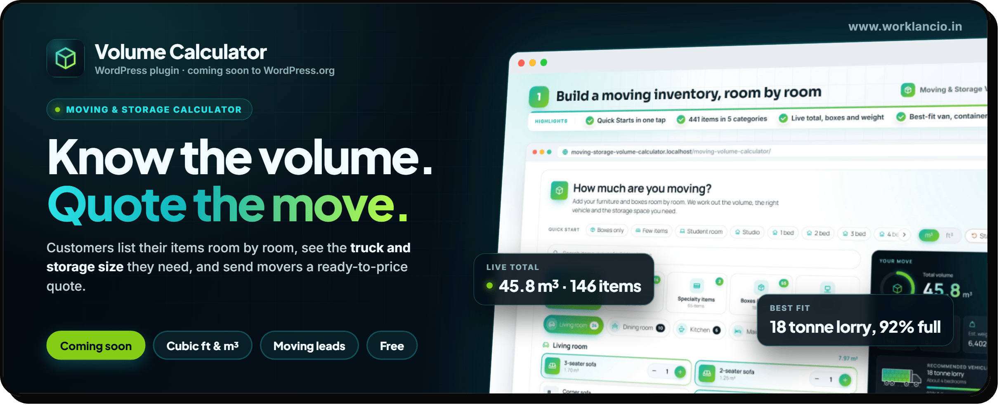</a>

A free moving volume calculator for moving, removal and storage companies. Customers list their items room by room in cubic feet or cubic metres, see the truck, container and storage unit size they need, and send a ready-to-price quote that lands in a built-in leads screen. Coming soon to WordPress.org.

<a href="https://youtu.be/raBU40QdFeY">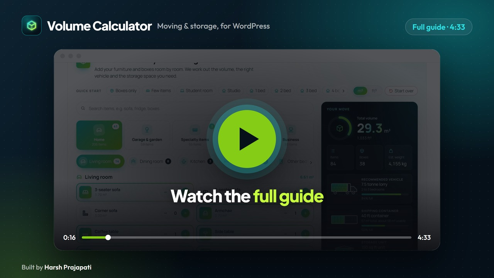</a>

[Watch the full guide on YouTube (4:33)](https://youtu.be/raBU40QdFeY)

[Case study](https://www.worklancio.in/work/volume-calculator) · [Download the latest release](https://github.com/xaviermsd/moving-storage-volume-calculator/releases/latest) · [Code](https://github.com/xaviermsd/moving-storage-volume-calculator)

---

### SitePatch Hub: agency dashboard for WordPress

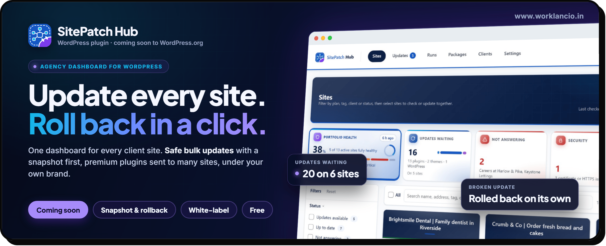

A free, self-hosted dashboard for agencies and freelancers who look after many WordPress sites. See every client site on one screen, run safe bulk updates with a snapshot first and automatic rollback, send premium plugins to many sites and sign in with one click, all under your own agency brand. Coming soon to WordPress.org.

---

### SitePatch Connect: client site connector for SitePatch Hub

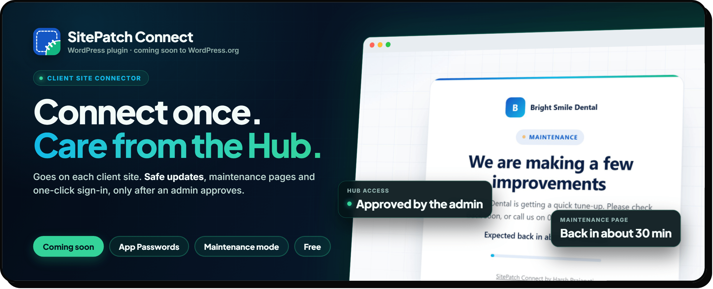

The free plugin that goes on each client site. Once an administrator approves it with a WordPress Application Password, the Hub can run safe updates with rollback, turn on maintenance or coming soon pages, sign in with one click and read the Site Health report. Coming soon to WordPress.org.

## Tech stack

  
  
  
  
  
  
  
  
  
  
  

Also: MySQL, WooCommerce, ACF, Elementor, REST APIs, Git and Shopify.

## Let's work together

<a href="https://wa.me/919898528376?text=Hi%20Harsh%2C%20I%20saw%20your%20GitHub%20profile%20and%20have%20a%20project%20in%20mind.">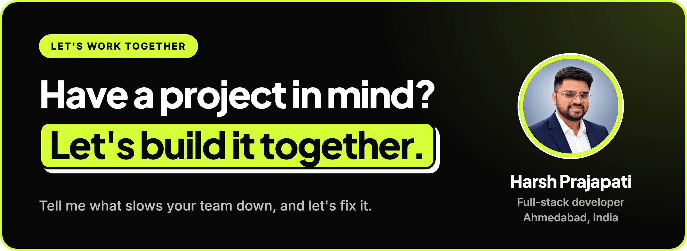</a>

I'm open to one-off builds and long-term work. Send a short note about what you need and I'll come back with questions or a clear next step. You can also see my services and pricing at [worklancio.in](https://www.worklancio.in).

  &nbsp;
  &nbsp;
  

  &nbsp;
  &nbsp;
  &nbsp;
  

