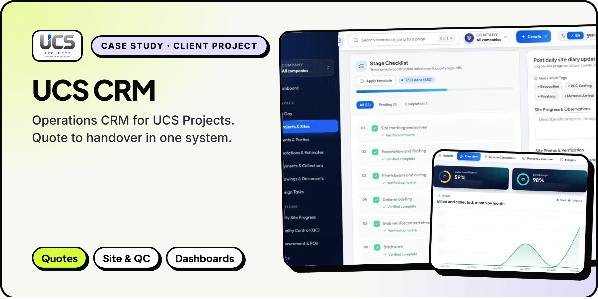
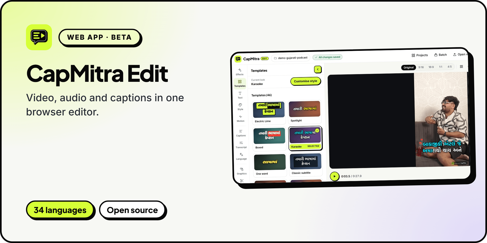
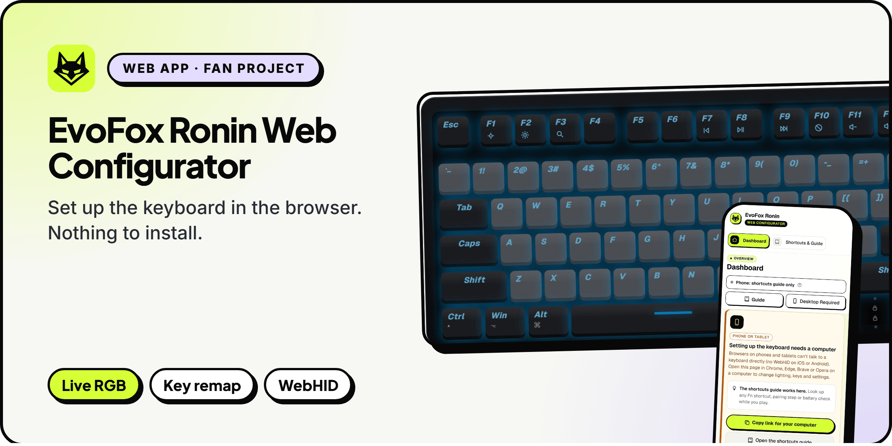
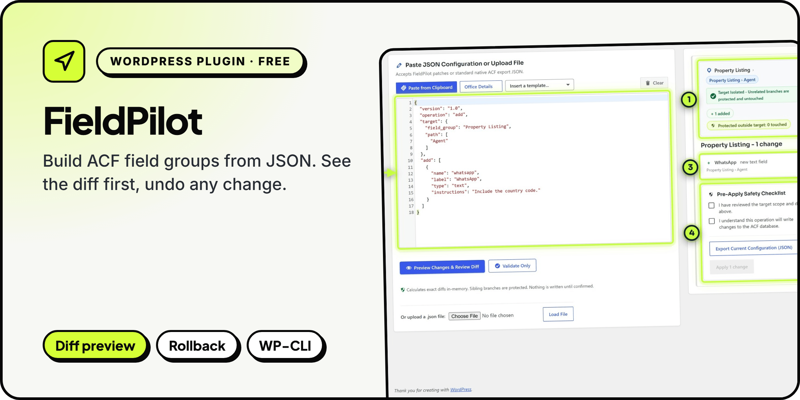
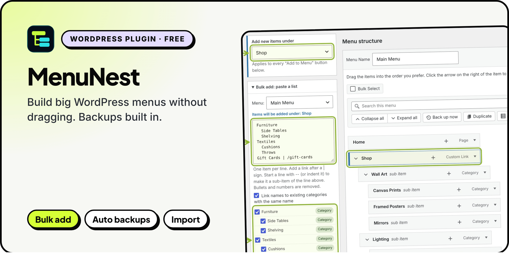

  

  &nbsp;
  

## Hi, I'm Harsh

I'm a freelance full-stack developer in Ahmedabad, India. I've been building for the web since 2018 and freelancing since 2022.

I work with business owners and small teams who have outgrown spreadsheets, scattered WhatsApp threads and manual follow-ups. I turn that into one clear system the whole team can use. You talk directly to the person writing the code, from the first call to launch and after.

## What I build

**Custom CRMs and business dashboards** 
See leads, projects, payments and your team's work in one place, with numbers you can trust.

**Web apps** 
Portals, internal tools and SaaS products that load fast, work on any phone and stay easy to change.

**WordPress plugins and sites** 
Fast sites your team can edit on its own, and custom plugins when off-the-shelf ones fall short.

**Business automation and integrations** 
Connect the tools you already pay for, so the repetitive work runs on its own.

## Featured work

### UCS CRM: operations CRM for UCS Projects

**Case study · client project for [UCS Projects](https://ucsprojects.in/) ([@ucsprojects](https://www.instagram.com/ucsprojects)), a construction and interiors firm. Client: Mehul Sharma.** One system that follows every project from the first quotation to the final handover, so the office and the site team work from the same data.

- Quotations through to payments and collections
- Projects, site execution and daily site diaries
- Procurement, accounts and quality checks (QC)
- Role-based access, so each person sees only what they need
- Live dashboards for collections, margins and project status

> "Harsh Prajapati did an excellent job developing the CRM for UCS Projects. His understanding, professionalism, and attention to detail made the entire process smooth. Highly recommended for his quality work and dedication. Great experience!"
>
> **UCS Projects** · Client: Mehul Sharma

**Stack:** Next.js · React · TypeScript · Tailwind CSS

Screens show demo data. The code and live system are private.

**Want one for your business? [Let's talk.](https://wa.me/919898528376?text=Hi%20Harsh%2C%20I%20saw%20your%20GitHub%20profile%20and%20have%20a%20project%20in%20mind.)**

---

### CapMitra Edit

Video, audio and captions in one browser editor. A multi-track timeline, noise reduction and music, word-by-word captions in 34 languages, and MP4 export up to 4K. Your video never leaves your device. Currently in invite-only beta.

[Live app](https://capmitra-app.vercel.app) · [Code](https://github.com/xaviermsd/capmitra-app)

---

### EvoFox Ronin Web Configurator

Set up the EvoFox Ronin wireless keyboard right in the browser over WebHID. All 21 RGB effects with a live preview, per-key colour, key remapping and profiles, with nothing to install.

An unofficial fan project, not affiliated with Amkette or EvoFox.

[Live app](https://ronin.xaviermsd.workers.dev) · [Code](https://github.com/xaviermsd/evofox-ronin-configurator)

---

### FieldPilot: AI &amp; JSON Copilot for ACF

Build ACF field groups from JSON. Copy a prompt with your real field names, paste the reply back, see the exact diff and apply. Every change can be rolled back. Free on WordPress.org.

[WordPress.org](https://wordpress.org/plugins/fieldpilot-for-acf/) · [Code](https://github.com/xaviermsd/fieldpilot-for-acf) · [Video tutorial](https://youtu.be/FjoeySz05xw)

---

### MenuNest: Smart Menu Manager for WordPress

Build big WordPress menus without dragging. Add items under any parent, paste a whole list at once, and back up, restore, import and export menus with a preview first. Free on WordPress.org.

[WordPress.org](https://wordpress.org/plugins/menunest-smart-menu-manager/) · [Code](https://github.com/xaviermsd/menunest-smart-menu-manager) · [Video tutorial](https://www.youtube.com/watch?v=SljKJXaSWe8)

## Tech stack

  
  
  
  
  
  
  
  
  
  
  

Also: MySQL, WooCommerce, ACF, Elementor, REST APIs, Git and Shopify.

## Let's work together

I'm open to one-off builds and long-term work. Send a short note about what you need and I'll come back with questions or a clear next step.

  &nbsp;
  &nbsp;
  

  &nbsp;
  &nbsp;
  

